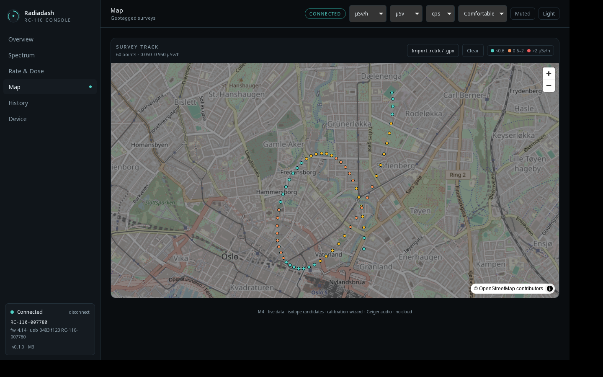
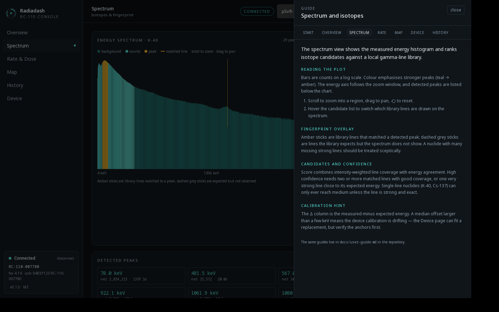

# Radiadash

An unofficial Linux dashboard for **RadiaCode 110** radiation detectors: live counts,
dose, spectra, isotope candidates and geotagged surveys in one native app.

> Status: **M5** — live dashboard, isotope candidates, calibration wizard, Geiger
> audio, distributions, layout densities and a survey map fed by `.rctrk`/GPX
> imports. Tested on a real RC-110 over BLE and USB.



## Why

The official app is polished but closed, and it doesn't run natively on Fedora.
Radiadash aims to be a fast, local-first desktop console:

- Bluetooth-first connection, USB fallback (same protocol over both)
- Live CPS, dose rate, accumulated dose, temperature, battery
- Spectrum view with energy calibration, peak search and isotope candidate ranking
- Flexible workspaces: an "everything" overview plus focused views per domain
- Charts and distributions with configurable ranges (minute → month)
- Geiger counter audio driven by the measured count rate
- Dark and light themes, unit switching (Sv, rem, Gy, rad, R, cps/cpm, keV/MeV)
- Map view for surveys (RC-110 has no GPS, so tracks come from imports, `gpsd` or manual pins)
- All data stays in a local SQLite database (`~/.local/share/io.github.martintondel.radiadash/`)

## What works today

- Auto-connect on launch: Bluetooth first, USB fallback, explicit transport pick
- Live CPS with error bars and a rolling chart, dose rate, accumulated dose
- Device panel: serial, firmware, battery, temperature, transport, flags
- Spectrum read every 60 s, stored and rendered with the device calibration
- Isotope candidates (35 nuclides, 100 lines) with confidence bands, a per-line
  evidence table, a library-line fingerprint overlay and a calibration hint
- Calibration wizard: robust fit of a0/a1/a2 from identified peaks, RMS guard,
  explicit confirmation before writing to the device
- Geiger audio generated from the measured CPS (Poisson-jittered clicks)
- Distributions: CPS and dose-rate histograms, ranges from 5 minutes to 24 hours
- Zoomable charts: scroll wheel or trackpad, drag to pan, +/− buttons and reset;
  colour-coded spectrum bars and category colours for isotope candidates
- Layout density: comfortable, compact or focus
- Survey map: import `.rctrk` (Radiacode phone app) or GPX tracks, tag the live
  reading at a location, filter by time, export GeoJSON/GPX/CSV
- In-app guides for every page (and a [markdown copy](docs/user-guide.md))


- Unit switching for dose rate, dose and count rate; dark/light themes
- Sessions stored in SQLite with downsampled series queries

## Requirements (Fedora 44)

```bash
sudo dnf install webkit2gtk4.1-devel gtk3-devel libsoup3-devel \
  javascriptcoregtk4.1-devel dbus-devel pkgconf-pkg-config gcc gcc-c++ make
# Rust (https://rustup.rs) and Node 22+ with pnpm
```

USB access needs a udev rule (the device is `0483:f123`, not a serial port):

```bash
sudo cp packaging/60-radiacode.rules /etc/udev/rules.d/
sudo udevadm control --reload-rules && sudo udevadm trigger
```

## Install (RPM)

```bash
sudo dnf install ./Radiadash-0.1.0-1.x86_64.rpm
sudo udevadm control --reload-rules && sudo udevadm trigger
```

The package includes the USB udev rule. See [docs/packaging.md](docs/packaging.md)
for contents and build details.

## Build and run

```bash
pnpm install
pnpm tauri dev                 # development
pnpm tauri build --bundles rpm # package (RPM)
```

Without a device, use the simulator:

```bash
cargo run -p radiadash-probe -- sim
```

## Probe (hardware bring-up)

The probe is the smallest way to check a device and to capture fixtures:

```bash
cargo run -p radiadash-probe -- list          # USB list + BLE scan
cargo run -p radiadash-probe -- info          # identity, units, calibration
cargo run -p radiadash-probe -- monitor --duration 60
cargo run -p radiadash-probe -- spectrum --plot --out spectrum.json
cargo run -p radiadash-probe -- record --duration 300 --out session.jsonl
```

`info` prints both plausible dose interpretations — compare with the device's own
display to settle the raw unit question (see [docs/protocol.md](docs/protocol.md)).

## Architecture

```
crates/radiadash-core   protocol, USB/BLE transports, decoders, units, spectrum math
crates/radiadash-sim    synthetic spectra/records, replay (dev + tests)
crates/radiadash-probe  CLI for bring-up, fixtures and diagnostics
apps/desktop            Tauri v2 shell + React/TypeScript UI
```

See [docs/architecture.md](docs/architecture.md), [docs/protocol.md](docs/protocol.md) and
[docs/isotopes.md](docs/isotopes.md), [docs/calibration.md](docs/calibration.md) and
[docs/map.md](docs/map.md) and [docs/packaging.md](docs/packaging.md).

## Roadmap

| Milestone | Content |
| --- | --- |
| M0 ✅ | Repository, CI, Tauri/React scaffold, design tokens |
| M1 ✅ | Protocol core, USB + BLE, probe CLI, simulator, tests |
| M2 ✅ | Live dashboard, SQLite sessions, units, auto-connect |
| M3 ✅ | Spectrum analysis, isotope library, fingerprint overlay, evidence UI |
| M4 ✅ | Calibration wizard, distributions, Geiger audio, layout density |
| M5 ✅ | Map view, `.rctrk`/GPX import, dose-coloured track (live geotagging pending) |
| M6 🚧 | RPM packaging ✅ · device settings, AppImage, release workflow pending |

## Credits and licence

MIT. Protocol knowledge is based on the MIT-licensed
[`cdump/radiacode`](https://github.com/cdump/radiacode) project; see [NOTICE](NOTICE).
Radiadash is not affiliated with Radiacode.
